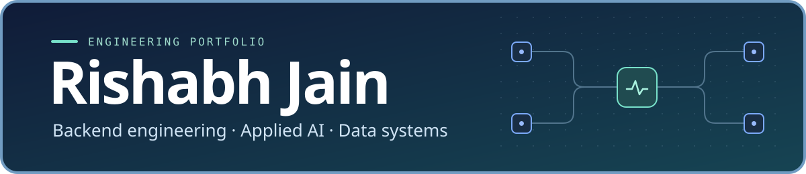

<h1 align="center"></h1>

  
  
  
  

  
  
  
  

I'm a final-year B.Tech Computer Science student at **Amity University, Noida (8.86 CGPA)**. I build backend and applied AI systems for pipeline monitoring, code exploration, and document retrieval. As an AI Engineering Intern at Marksman Technologies, I helped ship a lead qualification tool used by the sales team.

I'm interested in software engineering roles focused on **backend systems, data infrastructure, and applied AI**.

## Selected projects

### PipeGuard · Data pipeline observability

  
  
  

PipeGuard monitors an Airflow and dbt workload, records execution attempts and data quality results, and traces which datasets a run touches. It preserves earlier failures after a successful retry. Operators can review incident evidence, request an AI investigation, and separately approve a scoped recovery action.

**Stack** · Python, FastAPI, PostgreSQL, Airflow, dbt, OpenLineage, Next.js

**Verification** · 599 automated tests and both hosted CI jobs passed at the November 2026 checkpoint.

<strong>Show dashboard screenshot</strong>

- **[CritHop](https://github.com/RJ1899157/CritHop)** · Answers multi-hop questions by traversing a passage graph and checking evidence relevance and support along the way. Phase 2 uses a trained reranker to score passage relevance.
- **[Codebase Oracle](https://github.com/RJ1899157/codebase-oracle)** · Parses repositories into a symbol and dependency graph. Combines 2D and 3D exploration with GraphRAG answers that cite source files and line ranges.
- **[AirForce](https://github.com/RJ1899157/aws-envhacks)** · Models indoor air quality in a 3D floor-plan builder. Uses browser-based simulation to show how airflow and pollution change across rooms.
- **[reranker-slm](https://github.com/RJ1899157/reranker-slm)** · Fine-tunes Qwen2.5-0.5B with QLoRA on MS MARCO passage pairs for relevance scoring. The adapter powers CritHop's trained relevance check.
- **[API Docs RAG](https://github.com/RJ1899157/api-docs-rag-api)** · Searches 1,220 GitHub REST operations from the OpenAPI spec using dense and keyword retrieval. Returns answers with source links and abstains when evidence is insufficient.

## More projects

- **[BigQuery Release Radar](https://github.com/RJ1899157/bigquery-release-radar)** · Search and filter BigQuery release notes in a Flask dashboard, with caching and CSV export.
- **[Brand Builder](https://github.com/RJ1899157/brand-builder)** · Generate product advertising mockups for billboard, newspaper, and social formats.
- **[The Tiebreaker](https://github.com/RJ1899157/the-tiebreaker)** · Compare options using weighted criteria, pros and cons, and SWOT analysis.
- **[Car Sales Prediction](https://github.com/RJ1899157/car-sales-prediction)** · Compare linear regression and tuned random forests on a customer purchasing capacity dataset.
- **[DSA solutions](https://github.com/RJ1899157/DSA)** · Topic-organized C++ solutions and a separate [LeetCode practice log](https://github.com/RJ1899157/LEETCODE_PROBLEMS).

## Evaluation highlights

In CritHop's documented evaluation, the Phase 2 reranker improved exact match (EM) over the reported HopRAG baseline on all three datasets.

| Dataset | HopRAG EM | CritHop Phase 2 EM | Gain |
| --- | ---: | ---: | ---: |
| HotpotQA | 62.00 | **66.20** | +4.20 pts |
| MuSiQue | 42.20 | **45.90** | +3.70 pts |
| 2WikiMultiHopQA | 61.10 | **65.40** | +4.30 pts |

[Read the CritHop benchmark results](https://github.com/RJ1899157/CritHop)

API Docs RAG retrieved the expected operation in its top three results on **20 of 29 evaluation queries (68.97% Hit@3)**.

[Read the API Docs RAG evaluation](https://github.com/RJ1899157/api-docs-rag-api#evaluation-and-tests)

## Tools I work with

| Area | Tools |
| --- | --- |
| Languages | Python, TypeScript, SQL, C++, Java |
| Backend and data | FastAPI, PostgreSQL, Airflow, dbt, OpenLineage |
| Retrieval and model evaluation | Neo4j, Qdrant, Tree-sitter, BM25, BGE, RAGAS, Hugging Face, QLoRA |
| Product and delivery | React, Next.js, React Flow, Three.js, Docker Compose, GitHub Actions |

## Experience & education

- **Marksman Technologies** · AI Engineering Intern. Helped build a hybrid lead qualification engine and sales intelligence tools.
- **Amity University, Noida** · B.Tech in Computer Science and Engineering, **8.86 CGPA**.

### Selected credentials

| Credential | Issuer | Year | Verification |
| --- | --- | --- | --- |
| Google AI Professional Certificate | Google / Coursera | 2026 | [Verify](https://www.coursera.org/verify/professional-cert/3NAD47L24TII) |
| Mastering Data Structures & Algorithms using C and C++ | Abdul Bari / Udemy | 2026 | [Verify](https://www.udemy.com/certificate/UC-e5974809-1bc1-4d2e-b7b6-84f97b7e917e/) |
| CCNA Introduction to Networking | Cisco Networking Academy | 2024 | — |
| Python for Data Science | IIT Madras / NPTEL | 2024 | — |
| Google AI Essentials | Google | 2024 | — |
